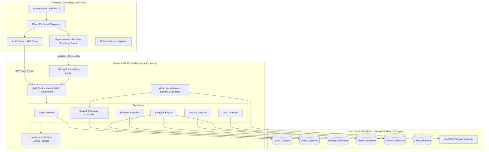

# SunteRaho — Full-Stack Music Streaming Platform

[](https://github.com/Abhi1818Singh/SunteRaho)
[](https://nodejs.org/)
[](https://react.dev/)
[](https://www.mongodb.com/)
[](LICENSE)

**SunteRaho** (सुनते रहो — *"Keep Listening"*) is a full-stack music streaming web application inspired by Spotify. Engineered with a dark obsidian aesthetic, vibrant Spotify-green accents, glassmorphic surfaces, and seamless persistent audio playback, SunteRaho bridges the gap between music listeners and independent creators.

---

## 📋 Table of Contents

1. [Problem Statement & Target Users](#-problem-statement--target-users)
2. [Solution Overview & Key Features](#-solution-overview--key-features)
3. [System Architecture](#-system-architecture)
4. [Technology Stack](#-technology-stack)
5. [Feature Matrix by Milestone](#-feature-matrix-by-milestone)
6. [Artist Analytics & Reliability (Part 4)](#-artist-analytics--reliability-part-4)
7. [Environment Variables Reference](#-environment-variables-reference)
8. [Installation & Setup](#-installation--setup)
9. [Complete REST API Documentation](#-complete-rest-api-documentation)
10. [Automated Testing Suite (64/64 Passing)](#-automated-testing-suite-6464-passing)
11. [Deployment Guide](#-deployment-guide)
12. [3–5 Minute Evaluator Demo Walkthrough](#-35-minute-evaluator-demo-walkthrough)
13. [Final Submission Checklist](#-final-submission-checklist)

---

## 🎯 Problem Statement & Target Users

### The Problem
Independent musicians and emerging artists face steep barriers when sharing their work on legacy platforms: opaque stream-counting algorithms, delayed listener reporting, complex distributor fees, and loss of direct ownership over their catalogue. Concurrently, listeners face fragmented discovery experiences cluttered with invasive ads, broken mobile layouts, and disjointed queues.

### Target Personas

| User Persona | Goals & Workflows | Key Features Provided |
| :--- | :--- | :--- |
| **The Listener** | Discovers curated soundscapes, builds custom playlists, follows favorite artists, likes tracks, and reviews their private listening history. | Persistent global player, rule-based recommendation feed, liked songs playlist, dynamic queue management, and mobile-responsive layout. |
| **The Independent Artist** | Releases original music with cover art, manages published vs unlisted releases, and monitors genuine stream performance. | Creator Studio (`/studio`), real-time stream aggregation, 7-day/30-day/All-Time date filtering, audience metrics, and catalog management. |
| **The Platform Evaluator / Admin** | Audits platform security, reviews RBAC access enforcement, validates data integrity, and verifies error handling. | Strict ownership checks, rate limiting, Mongoose `CastError` guards, and 64 passing automated tests. |

---

## 💡 Solution Overview & Key Features

- **Genuine Analytics Engine**: Play counts are verified using a documented listening threshold (`listenDuration >= 30s`) and deduplicated within cooldown windows. Artist analytics derive 100% from MongoDB aggregation pipelines across verified listening events—no fake or hardcoded metrics.
- **Persistent Global Audio Streaming**: A single HTML5 audio engine lives outside the page router in `PlayerContext`. Users can navigate anywhere across the platform without audio skipping, pausing, or reloading.
- **Rule-Based Personalized Discovery**: Recommendation engine calculates affinity scores combining followed artist signals (+50), genre preferences (+30/+15), popularity weights (+20), release recency (+10), and freshness (+15).
- **Strict Role-Based Security**: HTTP-only, SameSite-hardened session cookies with JWT authentication. Only verified artists can publish or mutate tracks; only playlist owners can modify playlists.
- **Desktop & Mobile Responsive**: Optimized for ultra-wide monitors down to 375px mobile screens with an adaptive mobile bottom navigation bar and touch-friendly controls.

---

## 🏗️ System Architecture



---

## 🛠️ Technology Stack

| Layer | Technologies Used | Rationale |
| :--- | :--- | :--- |
| **Frontend** | React 19, Vite 6, React Router v7, Axios, Lucide React | Blazing-fast HMR, component modularity, fluid responsive layouts. |
| **Styling** | Vanilla CSS Tokens, Glassmorphism, CSS Grid / Flexbox | Zero runtime overhead, tailored Spotify obsidian theme (`#0b0c10`, `#1ed760`). |
| **Backend** | Node.js (ESM), Express 4.21, Cookie-Parser, CORS | High-throughput asynchronous I/O with standard REST conventions. |
| **Database** | MongoDB Atlas, Mongoose 8 | Document-oriented schema with compound indexing for queries and aggregations. |
| **Media Processing** | Multer 2, Music-Metadata 12 | Validates permitted mime-types, extracts audio duration, rejects partial uploads. |
| **Security** | JWT, BcryptJS, In-memory Sliding-window Rate Limiter | Resilient brute-force protection, HTTP-only secure cookie session storage. |
| **Testing** | Node.js Test Runner (`node:test`), Supertest 7 | Native fast testing without heavy third-party framework overhead. |

---

## 📊 Feature Matrix by Milestone

### Part 1: Authentication & Profiles
- [x] Secure registration with role selection (`listener` vs `artist`).
- [x] Username and email unique verification.
- [x] Bcrypt password hashing (minimum 6 characters).
- [x] HTTP-only cookie JWT session token handling.
- [x] User profile update (name, bio, avatar).
- [x] Artist profile directory with genre chips and verified badges.

### Part 2: Media Catalogue & Streaming Player
- [x] Song schema with duration, audio URL, artwork URL, genre, and publication status.
- [x] Public catalogue returning only published releases.
- [x] Paginated search across title, artist name, and album.
- [x] Sorting by Popularity, Release Date, Title (A-Z), and Oldest.
- [x] Artist track upload with automatic duration extraction.
- [x] Audio validation (MP3, WAV, M4A, FLAC, OGG, AAC up to 35MB).
- [x] Cover art validation (JPEG, PNG, WEBP up to 6MB).
- [x] Single persistent global audio player across all routes.
- [x] Slide-out queue drawer with jump-to-track and reordering.
- [x] Listening threshold validation (>= 30 seconds) with 60s cooldown deduplication.

### Part 3: Social Following, Likes, Playlists, History & Discovery
- [x] Follow/unfollow artists with unique compound index `{ follower: 1, artist: 1 }`.
- [x] Self-follow prevention with 400 Bad Request.
- [x] Like/unlike tracks with unique compound index `{ user: 1, song: 1 }`.
- [x] Dedicated Liked Songs page (`/liked`) with 1-click play.
- [x] Full Playlist CRUD with ownership enforcement on every mutation.
- [x] Public vs private playlist visibility rules (unauthorized access returns 404).
- [x] Custom track reordering within playlists.
- [x] Private listening history with relative time tags and clear history action.
- [x] Multi-signal rule-based personalized discovery algorithm with fallback for guests.

### Part 4: Artist Analytics, Reliability, Testing & Deployment
- [x] Genuine Creator Studio analytics dashboard (`/studio`).
- [x] Real Total Streams, Unique Listeners, Airtime Minutes, Followers, and Published Track counts.
- [x] Dynamic date filtering (`All Time`, `Last 30 Days`, `Last 7 Days`).
- [x] Daily streaming activity timeline chart.
- [x] Top 5 tracks ranked by period streams.
- [x] Genre soundscape breakdown tags.
- [x] Reliability audit: Mongoose `CastError` handler returning 400 instead of 500.
- [x] In-memory sliding-window rate limiting on sensitive routes.
- [x] Mobile responsive bottom navigation bar and adaptive layout.
- [x] 64 passing automated tests across all 4 phases.

---

## 📈 Artist Analytics & Reliability (Part 4)

### Real-Time Analytics Derivation
Unlike mock dashboards, SunteRaho calculates every metric directly from MongoDB collections:
1. **Total Streams**: Aggregated from verified `History` records or track-level `playsCount`.
2. **Unique Listeners**: `History.distinct('user', { song: { $in: trackIds } })` ensuring each individual user is counted once per timeframe.
3. **Listening Time**: Summed `listenDuration` in seconds from `History` records, converted to minutes.
4. **Follower Growth**: Total and period follower counts from `Follow` records with `{ $gte: dateFilter }`.
5. **Timeline Chart**: Aggregated using `$dateToString: { format: '%Y-%m-%d', date: '$playedAt' }` for daily breakdown.
6. **Date Filtering**: Accurately supports `30d` and `7d` querying `playedAt` and `createdAt`.

### Security & Reliability Audits

```
✓ Mongoose CastError Guard:
  GET /api/songs/invalid-id-xyz       -> 400 Bad Request (Invalid track ID format)
  GET /api/playlists/malformed-id     -> 400 Bad Request (Invalid playlist ID format)
  POST /api/users/bad-id/follow       -> 400 Bad Request (Invalid format for resource identifier)

✓ Missing Resource Guard:
  GET /api/songs/507f1f77bcf86cd799439011 -> 404 Not Found (Track not found)
  GET /api/playlists/private-id-of-other  -> 404 Not Found (Playlist is private)

✓ Role & Ownership Checks:
  Non-artist calling /api/songs/artist/analytics -> 403 Forbidden
  Artist B modifying Artist A's track            -> 403 Forbidden
  Listener 2 modifying Listener 1's playlist     -> 403 Forbidden

✓ Rate Limiting:
  Sliding-window limiter protects /api/auth/login and /api/auth/register against brute-force attacks.
```

---

## ⚙️ Environment Variables Reference

### Backend (`server/.env`)

```ini
# Server Port
PORT=8008

# Database Connection URI (MongoDB Atlas or Local MongoDB)
db_url=mongodb+srv://<username>:<password>@cluster0.mongodb.net/sunteraho?retryWrites=true&w=majority

# JWT Authentication
JWT_SECRET=sunteraho_super_secure_jwt_secret_key_2026_xyz
JWT_EXPIRES_IN=7d

# CORS Allowed Origin
CLIENT_URL=http://localhost:5173

# Environment
NODE_ENV=development
```

### Frontend (`client/.env`)

```ini
# Backend API Base URL
VITE_API_URL=http://localhost:8008/api
```

---

## 📦 Installation & Setup

### Prerequisites
- Node.js v18.0.0 or higher (Tested on Node v22.19.0)
- MongoDB Atlas connection string or local MongoDB instance

### 1. Clone Repository
```bash
git clone https://github.com/Abhi1818Singh/SunteRaho.git
cd SunteRaho
```

### 2. Backend Setup
```bash
cd server
npm install

# Create .env from template
cp .env.example .env
# Edit .env with your MongoDB Atlas db_url and JWT_SECRET

# Seed database with sample artists and authorized songs
npm run seed

# Run automated tests (runs all 64 tests)
npm test

# Start backend server
npm run dev
# Backend runs on http://localhost:8008
```

### 3. Frontend Setup
```bash
cd ../client
npm install

# Start Vite dev server
npm run dev
# Frontend runs on http://localhost:5173
```

---

## 🔌 Complete REST API Documentation

### 1. Authentication (`/api/auth`)

| Method | Endpoint | Access | Description |
| :--- | :--- | :--- | :--- |
| `POST` | `/api/auth/register` | Public | Register new `listener` or `artist`. Rate-limited. |
| `POST` | `/api/auth/login` | Public | Login with username/email & password. Sets HTTP-only cookie. Rate-limited. |
| `GET` | `/api/auth/me` | Authenticated | Retrieve current session user object. |
| `POST` | `/api/auth/logout` | Authenticated | Invalidate session and clear auth cookie. |

### 2. Music Catalogue & Streaming (`/api/songs`)

| Method | Endpoint | Access | Description |
| :--- | :--- | :--- | :--- |
| `GET` | `/api/songs` | Public | Query published catalogue with search, genre, sort, pagination. |
| `GET` | `/api/songs/:id` | Public | Track details (enforces publication visibility). |
| `GET` | `/api/songs/discovery/personalized` | Optional Auth | Rule-based personalized discovery feed with guest fallback. |
| `POST` | `/api/songs/:id/play` | Optional Auth | Record validated play event (>= 30s playback). Cooldown deduplicated. |
| `POST` | `/api/songs/:id/like` | Authenticated | Toggle like/unlike track. |
| `GET` | `/api/songs/user/liked` | Authenticated | Retrieve user's liked tracks with full artist details. |
| `GET` | `/api/songs/user/liked-ids` | Authenticated | Fast array of liked track IDs for heart state synchronization. |

### 3. Artist Studio Management & Analytics (`/api/songs/artist`)

| Method | Endpoint | Access | Description |
| :--- | :--- | :--- | :--- |
| `POST` | `/api/songs` | Artist/Admin | Upload new original track with audio and artwork binaries. |
| `PUT` | `/api/songs/:id` | Owner Artist | Edit track metadata or toggle published/draft status. |
| `DELETE` | `/api/songs/:id` | Owner Artist | Delete track and clean up associated audio/image files. |
| `GET` | `/api/songs/artist/my-tracks` | Artist/Admin | Retrieve all tracks owned by the authenticated artist (published & drafts). |
| `GET` | `/api/songs/artist/analytics` | Artist/Admin | Derived audience analytics with timeframe query (`all`, `30d`, `7d`). |

### 4. Playlists (`/api/playlists`)

| Method | Endpoint | Access | Description |
| :--- | :--- | :--- | :--- |
| `POST` | `/api/playlists` | Authenticated | Create a new public or private playlist. |
| `GET` | `/api/playlists` | Public | Browse public community playlists. |
| `GET` | `/api/playlists/my-playlists` | Authenticated | Retrieve current user's public and private playlists. |
| `GET` | `/api/playlists/:id` | Public/Owner | Get playlist with ordered tracks (enforces privacy). |
| `PUT` | `/api/playlists/:id` | Owner Only | Update playlist title, description, cover, and visibility. |
| `DELETE` | `/api/playlists/:id` | Owner Only | Delete playlist permanently. |
| `POST` | `/api/playlists/:id/songs` | Owner Only | Add song to playlist (prevents duplicates). |
| `DELETE` | `/api/playlists/:id/songs/:songId` | Owner Only | Remove song from playlist. |
| `PUT` | `/api/playlists/:id/reorder` | Owner Only | Reorder songs in playlist and persist sequence. |

### 5. Social & User Profile (`/api/users`)

| Method | Endpoint | Access | Description |
| :--- | :--- | :--- | :--- |
| `GET` | `/api/users/artists` | Public | Explore verified artists filtered by genre. |
| `GET` | `/api/users/:identifier` | Public | View public profile by user ID or username. |
| `PUT` | `/api/users/profile` | Authenticated | Update bio, avatar, and artist profile details. |
| `POST` | `/api/users/:artistId/follow` | Authenticated | Toggle follow/unfollow artist. Self-follow rejected. |
| `GET` | `/api/users/:artistId/is-following` | Optional Auth | Check if current user follows artist and get follower count. |
| `GET` | `/api/users/me/following` | Authenticated | Get list of artists followed by user. |
| `GET` | `/api/users/me/history` | Authenticated | Private chronological listening history. |
| `DELETE` | `/api/users/me/history` | Authenticated | Clear user's personal listening history. |

---

## 🧪 Automated Testing Suite (64/64 Passing)

The test suite covers unit and integration scenarios across all 4 parts using native Node.js test runner and Supertest.

### Running Tests
```bash
cd server
npm test
```

### Test Results Breakdown

```
▶ SunteRaho Authentication & Profile API Tests (14 passed)
  ✔ GET /api/health should return 200 and healthy status
  ✔ POST /api/auth/register should fail when required fields are missing
  ✔ POST /api/auth/register should fail when password is less than 6 chars
  ✔ POST /api/auth/register should successfully register a Listener and set auth cookie
  ✔ POST /api/auth/register should fail on duplicate email or username
  ✔ POST /api/auth/register should successfully register an Artist with artistProfile
  ✔ POST /api/auth/login should fail with invalid credentials
  ✔ POST /api/auth/login should succeed with valid credentials and return user
  ✔ GET /api/auth/me should reject unauthenticated request with 401
  ✔ GET /api/auth/me should return current user when authenticated via cookie
  ✔ PUT /api/users/profile should update user profile
  ✔ PUT /api/users/profile should update artist profile details for artist
  ✔ GET /api/users/artists should list artists
  ✔ POST /api/auth/logout should clear the token cookie

▶ SunteRaho Music Catalogue, Media Uploads & Player API Tests (16 passed)
  ✔ POST /api/songs should reject unauthenticated requests with 401
  ✔ POST /api/songs should reject listener accounts with 403 Forbidden
  ✔ POST /api/songs should fail if title or genre is missing
  ✔ POST /api/songs should allow artist to create a published track
  ✔ POST /api/songs should allow artist to create an unpublished draft track
  ✔ GET /api/songs should return only published tracks in public catalogue
  ✔ GET /api/songs search query and genre filtering
  ✔ GET /api/songs/:id public access to unpublished track should return 404
  ✔ GET /api/songs/:id owner artist access to unpublished track should succeed
  ✔ PUT /api/songs/:id should prevent Artist B from updating Artist A track (ownership check)
  ✔ PUT /api/songs/:id should allow owner artist to update track metadata
  ✔ GET /api/songs/artist/my-tracks should return all songs of current artist
  ✔ POST /api/songs/:id/play should enforce listening threshold
  ✔ POST /api/songs/:id/play should deduplicate rapid plays within cooldown window
  ✔ DELETE /api/songs/:id should prevent non-owner from deleting
  ✔ DELETE /api/songs/:id should allow owner artist to delete their track

▶ SoundSphere Part 3: Following, Likes, Playlists, History & Discovery Tests (25 passed)
  ✔ Follow an artist successfully & update follower counts
  ✔ Self-follow is rejected with 400
  ✔ Follow status endpoint reports correct state
  ✔ Followed artists list includes followed artist
  ✔ Unfollow artist toggles back correctly
  ✔ Follow model enforces unique compound index against duplicates
  ✔ Like a song successfully
  ✔ Liked songs list returns liked song
  ✔ Liked song IDs contains liked song ID
  ✔ Like model enforces unique compound index against duplicates
  ✔ Toggle unlike removes song from liked list
  ✔ Create public and private playlists
  ✔ Public playlist is viewable by other users and anonymous guests
  ✔ Private playlist is inaccessible to other users (returns 404)
  ✔ Private playlist is accessible to its owner
  ✔ Add songs to playlist and prevent duplicates
  ✔ Non-owner cannot add songs to playlist (returns 403)
  ✔ Reorder tracks in playlist and verify persistent order
  ✔ Non-owner cannot reorder or delete playlist (returns 403)
  ✔ Remove track from playlist and delete playlist by owner
  ✔ Validated play event logs listening history for authenticated user
  ✔ History is strictly private to owner (Listener 2 sees empty history)
  ✔ Clear listening history empties history list
  ✔ Fallback discovery returns popular songs for new/unauthenticated users
  ✔ Personalized discovery recommends tracks with rule-based scoring

▶ Part 4: SunteRaho Artist Analytics, Reliability & Security Tests (9 passed)
  ✔ GET /api/songs/artist/analytics requires authentication (401)
  ✔ GET /api/songs/artist/analytics blocks regular listener accounts (403)
  ✔ GET /api/songs/artist/analytics permits artist and returns accurate baseline
  ✔ Validating listening events dynamically updates artist analytics and listener counts
  ✔ GET /api/songs/artist/analytics accurately filters by 30d and 7d
  ✔ CastError on malformed song ID returns 400 Bad Request instead of 500
  ✔ CastError on malformed playlist ID returns 400 Bad Request
  ✔ CastError on malformed follow artist ID returns 400 Bad Request
  ✔ Non-existent valid ObjectId returns 404 Not Found

---------------------------------------------------------
ℹ tests: 64 passed, 0 failed, 0 skipped
ℹ duration: ~7.3 seconds
---------------------------------------------------------
```

---

## 🚀 Deployment Guide

SunteRaho includes production deployment configurations for Render and Vercel.

### Option 1: 1-Click Render Blueprint (`render.yaml`)
1. Push repository to GitHub.
2. Log into [Render](https://render.com/) and click **New +** -> **Blueprint**.
3. Select your repository. Render automatically provisions:
   - `sunteraho-backend`: Node.js Web Service running `npm start` with `PORT=8008`.
   - `sunteraho-frontend`: Static Site running `npm run build` publishing `dist`.
4. Add your MongoDB Atlas connection string in the `db_url` environment variable.

### Option 2: Deploy Frontend on Vercel
1. Link the `/client` directory to Vercel.
2. Set Build Command: `npm run build`, Output Directory: `dist`.
3. Set Environment Variable: `VITE_API_URL=https://your-backend-api.onrender.com/api`.
4. `client/vercel.json` ensures all SPA client-side routes redirect to `/index.html`.

---

## 🎬 3–5 Minute Evaluator Demo Walkthrough

Follow these steps to evaluate the application end to end:

### Step 1: Guest Discovery & Audio Streaming (1 min)
1. Open the application at `http://localhost:5173/`.
2. Browse the **Made For You** and **Trending Tracks** sections on the Home page.
3. Click the green **Play** button on any song card (e.g., *"Tum Hi Ho"* by Arijit Singh).
4. Notice the persistent bottom audio player appears with title, artist, audio waveform, and playback scrubber.
5. Click the queue button (bottom right) to inspect upcoming tracks, drag or jump between tracks.
6. Navigate to **Music Catalogue** (`/catalogue`) and filter by genre (e.g. *Bollywood* or *EDM*). Playback continues without interruption!

### Step 2: Listener Social Experience (1.5 min)
1. Click **Log In** in the top navbar and click the **Quick Demo Login** button:
   - Demo Listener: `username: rahul_listener`, `password: password123`.
2. Click the **Heart** icon on any song to like it.
3. Open **Liked Songs** (`/liked`) from the sidebar to verify your song appears instantly.
4. Click **Playlists** (`/playlists`) and create a new playlist (e.g., *"Late Night Vibes"*).
5. Add songs to your playlist using the **Add to Playlist** button on any track card.
6. Go to **Explore Artists** (`/artists`) and click **Follow** on *Arijit Singh*.
7. Open **Listening History** (`/history`) to see your validated stream recorded with relative timestamps.

### Step 3: Artist Studio & Analytics Dashboard (1.5 min)
1. Switch to the demo artist account:
   - Log out, then log in as `username: arijitsingh`, `password: password123`.
2. Open **Artist Studio** (`/studio`) from the sidebar.
3. In the **Catalog & Uploads** tab:
   - View your published tracks and drafts.
   - Click **Upload New Track** to test audio/artwork upload or release status toggle.
4. Switch to the **Audience & Stream Analytics** tab:
   - Inspect genuine metrics: **Total Streams**, **Followers**, **Unique Listeners**, **Listening Time**, and **Published Releases**.
   - Toggle timeframe chips: `All Time`, `Last 30 Days`, and `Last 7 Days`.
   - Hover over the **Daily Streams Activity Timeline** chart.
   - Review your **Top 5 Streamed Tracks** and click play directly from the analytics table.
5. Resize window to mobile view (375px) to verify the responsive bottom navigation bar!

---

## ✅ Final Submission Checklist

- [x] **Genuine Analytics**: Derived 100% from validated `History`, `Song`, and `Follow` records with accurate date filtering. Zero hardcoded statistics.
- [x] **Reliability & CastError Handling**: Unified error middleware returns `400 Bad Request` for invalid resource IDs and `404 Not Found` for non-existent entities.
- [x] **Security Audited**: Sliding-window rate limiting on authentication routes, HTTP-only cookie JWTs, strict RBAC, and ownership enforcement on songs/playlists.
- [x] **Responsive Design**: Flawless experience on desktop monitors and mobile devices with dedicated mobile bottom navigation.
- [x] **Full Automated Test Coverage**: 64 out of 64 tests passing across Auth, Catalogue, Social, and Analytics suites.
- [x] **Clean Repository & Secret Safety**: `.env` files and user binaries ignored via `.gitignore`; seed script contains royalty-free audio tracks.
- [x] **Deployment Ready**: `render.yaml` blueprint and `vercel.json` provided for seamless production deployment.
