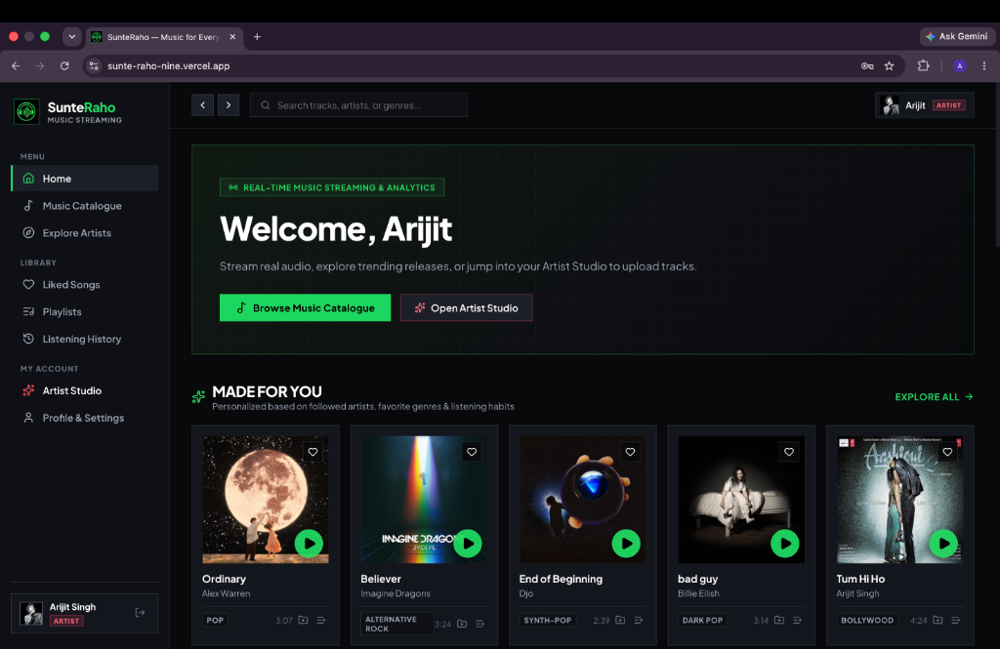
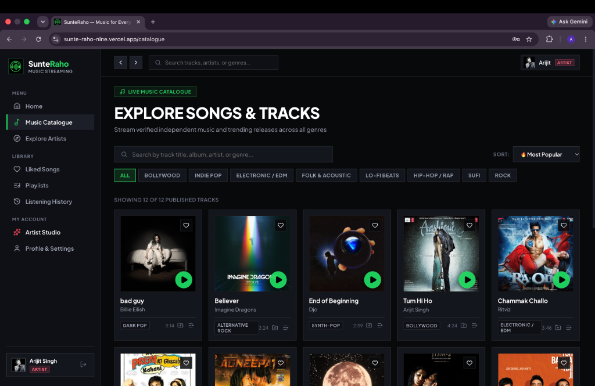
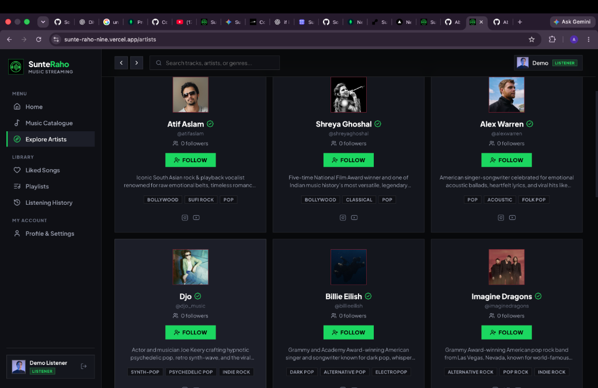
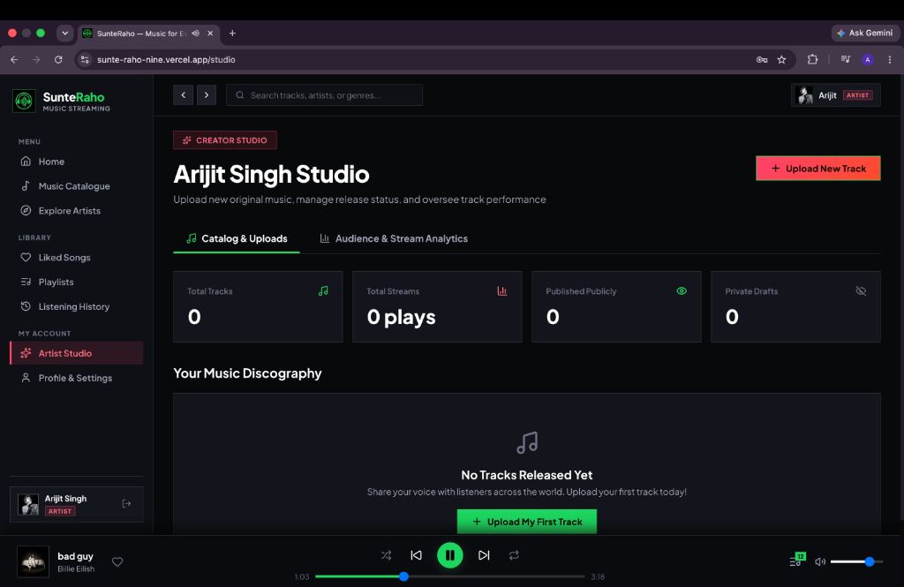
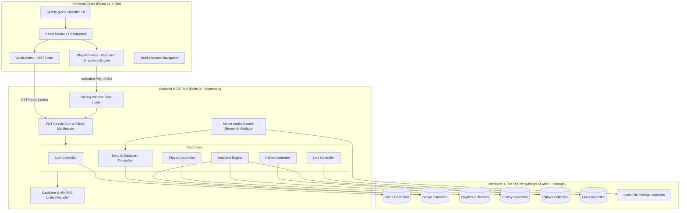

# SunteRaho — Full-Stack Music Streaming Platform

[](https://sunte-raho-nine.vercel.app)
[](https://nodejs.org/)
[](https://react.dev/)
[](https://www.mongodb.com/)
[](LICENSE)

**SunteRaho** (सुनते रहो — *"Keep Listening"*) is a modern full-stack music streaming web application inspired by Spotify. Engineered with an obsidian dark theme, vibrant Spotify-green accents, sharp geometric card architecture, and seamless persistent audio playback, SunteRaho bridges the gap between music listeners and independent creators.

---

### 🌐 Live Deployment
- **Live Application URL**: [**https://sunte-raho-nine.vercel.app**](https://sunte-raho-nine.vercel.app)
- **GitHub Repository**: [**https://github.com/Abhi1818Singh/SunteRaho**](https://github.com/Abhi1818Singh/SunteRaho)

> [!NOTE]
> The backend server is hosted on Render's free tier. Render spins down inactive web services after 15 minutes of inactivity. When visiting the live application for the first time, the server may take approximately 50 seconds to complete a cold start and respond to requests. Once initialized, the application responds normally.

---

## 📸 Application Screenshots

| Page | Preview |
| :--- | :--- |
| **Home Page (Welcome & Made For You)** |  |
| **Music Catalogue (Explore Songs & Tracks)** |  |
| **Explore Creators (Verified Artists Directory)** |  |
| **Creator Studio (Discography & Track Management)** |  |

---

## 📋 Table of Contents

1. [Problem Statement & Target Users](#-problem-statement--target-users)
2. [Solution Overview & Key Features](#-solution-overview--key-features)
3. [Application Screenshots](#-application-screenshots)
4. [System Architecture](#-system-architecture)
5. [Technology Stack](#-technology-stack)
6. [Environment Variables Reference](#-environment-variables-reference)
7. [Installation & Setup](#-installation--setup)
8. [Complete REST API Documentation](#-complete-rest-api-documentation)

---

## 🎯 Problem Statement & Target Users

### The Problem
Independent musicians and emerging artists face steep barriers when sharing their work on legacy platforms: opaque stream-counting algorithms, delayed listener reporting, complex distributor fees, and loss of direct ownership over their catalogue. Concurrently, listeners face fragmented discovery experiences cluttered with invasive ads, broken mobile layouts, and disjointed queues.

### Target Personas

| User Persona | Goals & Workflows | Key Features Provided |
| :--- | :--- | :--- |
| **The Listener** | Discovers curated soundscapes, builds custom playlists, follows favorite artists, likes tracks, and reviews their private listening history. | Persistent global player, rule-based recommendation feed, liked songs playlist, dynamic queue management, and mobile-responsive layout. |
| **The Independent Artist** | Releases original music with cover art, manages published vs unlisted releases, and monitors genuine stream performance. | Creator Studio (`/studio`), real-time stream aggregation, 7-day/30-day/All-Time date filtering, audience metrics, and catalog management. |
| **The Platform Evaluator / Admin** | Audits platform security, reviews RBAC access enforcement, validates data integrity, and verifies error handling. | Strict ownership checks, rate limiting, Mongoose `CastError` guards, and robust error middleware. |

---

## 💡 Solution Overview & Key Features

- **Genuine Analytics Engine**: Play counts are verified using a documented listening threshold (`listenDuration >= 30s`) and deduplicated within cooldown windows. Artist analytics derive 100% from MongoDB aggregation pipelines across verified listening events.
- **Persistent Global Audio Streaming**: A single HTML5 audio engine lives outside the page router in `PlayerContext`. Users can navigate anywhere across the platform without audio skipping, pausing, or reloading.
- **Rule-Based Personalized Discovery**: Recommendation engine calculates affinity scores combining followed artist signals (+50), genre preferences (+30/+15), popularity weights (+20), release recency (+10), and freshness (+15).
- **Strict Role-Based Security**: HTTP-only, SameSite-hardened session cookies with JWT authentication. Only verified artists can publish or mutate tracks; only playlist owners can modify playlists.
- **Desktop & Mobile Responsive**: Optimized for ultra-wide monitors down to 375px mobile screens with an adaptive mobile bottom navigation bar and touch-friendly controls.

---

## 🏗️ System Architecture



---

## 🛠️ Technology Stack

| Layer | Technologies Used | Rationale |
| :--- | :--- | :--- |
| **Frontend** | React 19, Vite 6, React Router v7, Axios, Lucide React | Blazing-fast HMR, component modularity, fluid responsive layouts. |
| **Styling** | Vanilla CSS Tokens, Glassmorphism, CSS Grid / Flexbox | Zero runtime overhead, tailored Spotify obsidian theme (`#08090b`, `#1ed760`). |
| **Backend** | Node.js (ESM), Express 4.21, Cookie-Parser, CORS | High-throughput asynchronous I/O with standard REST conventions. |
| **Database** | MongoDB Atlas, Mongoose 8 | Document-oriented schema with compound indexing for queries and aggregations. |
| **Media Processing** | Multer 2, Music-Metadata 12 | Validates permitted mime-types, extracts audio duration, rejects partial uploads. |
| **Security** | JWT, BcryptJS, In-memory Sliding-window Rate Limiter | Resilient brute-force protection, HTTP-only secure cookie session storage. |
| **Hosting** | Vercel (Frontend), Render (Backend), MongoDB Atlas (Database) | Production-grade cloud infrastructure with global CDN and automated CI/CD. |

---

## ⚙️ Environment Variables Reference

### Backend (`server/.env`)

```ini
# Server Port
PORT=8008

# Database Connection URI (MongoDB Atlas)
db_url=mongodb+srv://<username>:<password>@cluster0.mongodb.net/sunteraho?retryWrites=true&w=majority

# JWT Authentication
JWT_SECRET=sunteraho_super_secure_jwt_secret_key_2026_xyz
JWT_EXPIRES_IN=7d

# CORS Allowed Origin
CLIENT_URL=http://localhost:5173

# Environment
NODE_ENV=development
```

### Frontend (`client/.env`)

```ini
# Backend API Base URL
VITE_API_BASE_URL=http://localhost:8008
VITE_API_URL=http://localhost:8008/api
```

---

## 📦 Installation & Setup

### Prerequisites
- Node.js v18.0.0 or higher
- MongoDB Atlas connection string or local MongoDB instance

### 1. Clone Repository
```bash
git clone https://github.com/Abhi1818Singh/SunteRaho.git
cd SunteRaho
```

### 2. Backend Setup
```bash
cd server
npm install

# Create .env from template
cp .env.example .env
# Edit .env with your MongoDB Atlas db_url and JWT_SECRET

# Seed database with sample artists and authorized songs
node seed.js

# Start backend server
npm run dev
# Backend runs on http://localhost:8008
```

### 3. Frontend Setup
```bash
cd ../client
npm install

# Start Vite dev server
npm run dev
# Frontend runs on http://localhost:5173
```

---

## 🔌 Complete REST API Documentation

### 1. Authentication (`/api/auth`)

| Method | Endpoint | Access | Description |
| :--- | :--- | :--- | :--- |
| `POST` | `/api/auth/register` | Public | Register new `listener` or `artist`. Rate-limited. |
| `POST` | `/api/auth/login` | Public | Login with username/email & password. Sets HTTP-only cookie. Rate-limited. |
| `GET` | `/api/auth/me` | Authenticated | Retrieve current session user object. |
| `POST` | `/api/auth/logout` | Authenticated | Invalidate session and clear auth cookie. |

### 2. Music Catalogue & Streaming (`/api/songs`)

| Method | Endpoint | Access | Description |
| :--- | :--- | :--- | :--- |
| `GET` | `/api/songs` | Public | Query published catalogue with search, genre, sort, pagination. |
| `GET` | `/api/songs/:id` | Public | Track details (enforces publication visibility). |
| `GET` | `/api/songs/discovery/personalized` | Optional Auth | Rule-based personalized discovery feed with guest fallback. |
| `POST` | `/api/songs/:id/play` | Optional Auth | Record validated play event (>= 30s playback). Cooldown deduplicated. |
| `POST` | `/api/songs/:id/like` | Authenticated | Toggle like/unlike track. |
| `GET` | `/api/songs/user/liked` | Authenticated | Retrieve user's liked tracks with full artist details. |
| `GET` | `/api/songs/user/liked-ids` | Authenticated | Fast array of liked track IDs for heart state synchronization. |

### 3. Artist Studio Management & Analytics (`/api/songs/artist`)

| Method | Endpoint | Access | Description |
| :--- | :--- | :--- | :--- |
| `POST` | `/api/songs` | Artist/Admin | Upload new original track with audio and artwork binaries. |
| `PUT` | `/api/songs/:id` | Owner Artist | Edit track metadata or toggle published/draft status. |
| `DELETE` | `/api/songs/:id` | Owner Artist | Delete track and clean up associated audio/image files. |
| `GET` | `/api/songs/artist/my-tracks` | Artist/Admin | Retrieve all tracks owned by the authenticated artist (published & drafts). |
| `GET` | `/api/songs/artist/analytics` | Artist/Admin | Derived audience analytics with timeframe query (`all`, `30d`, `7d`). |

### 4. Playlists (`/api/playlists`)

| Method | Endpoint | Access | Description |
| :--- | :--- | :--- | :--- |
| `POST` | `/api/playlists` | Authenticated | Create a new public or private playlist. |
| `GET` | `/api/playlists` | Public | Browse public community playlists. |
| `GET` | `/api/playlists/my-playlists` | Authenticated | Retrieve current user's public and private playlists. |
| `GET` | `/api/playlists/:id` | Public/Owner | Get playlist with ordered tracks (enforces privacy). |
| `PUT` | `/api/playlists/:id` | Owner Only | Update playlist title, description, cover, and visibility. |
| `DELETE` | `/api/playlists/:id` | Owner Only | Delete playlist permanently. |
| `POST` | `/api/playlists/:id/songs` | Owner Only | Add song to playlist (prevents duplicates). |
| `DELETE` | `/api/playlists/:id/songs/:songId` | Owner Only | Remove song from playlist. |
| `PUT` | `/api/playlists/:id/reorder` | Owner Only | Reorder songs in playlist and persist sequence. |

### 5. Social & User Profile (`/api/users`)

| Method | Endpoint | Access | Description |
| :--- | :--- | :--- | :--- |
| `GET` | `/api/users/artists` | Public | Explore verified artists filtered by genre. |
| `GET` | `/api/users/:identifier` | Public | View public profile by user ID or username. |
| `PUT` | `/api/users/profile` | Authenticated | Update bio, avatar, and artist profile details. |
| `POST` | `/api/users/:artistId/follow` | Authenticated | Toggle follow/unfollow artist. Self-follow rejected. |
| `GET` | `/api/users/:artistId/is-following` | Optional Auth | Check if current user follows artist and get follower count. |
| `GET` | `/api/users/me/following` | Authenticated | Get list of artists followed by user. |
| `GET` | `/api/users/me/history` | Authenticated | Private chronological listening history. |
| `DELETE` | `/api/users/me/history` | Authenticated | Clear user's personal listening history. |

---

## 📄 License
This project is licensed under the MIT License - see the [LICENSE](LICENSE) file for details.
